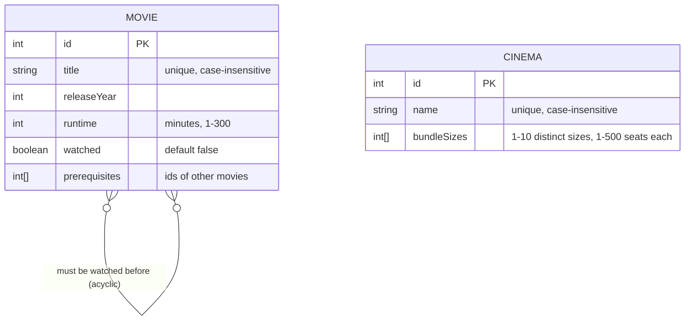

# Doomsday Ready

A small full-stack app that helps MCU fans **plan their rewatch** before *Avengers: Doomsday* and **book an opening-night watch party**.

- **Backend:** Node.js 20+ and Express, REST API under `/api`, data stored in a JSON file
- **Frontend:** React (Vite), three views: Movies, Rewatch Plan, Booking
- **Extras:** automated tests, Docker Compose, data model diagram

## Run it

### Option 1: Docker (one command)

```bash
docker compose up --build
```

- App: <http://localhost:8080>
- API: <http://localhost:3001/api> (also available through the app at `/api`)

The sample data from the brief (8 movies, 4 cinemas) is loaded on first start. Data is kept in a Docker volume. To start empty, set `SEED_DEMO: "false"` in `docker-compose.yml`. To reset everything, run `docker compose down -v`.

### Option 2: Locally (Node 20+)

```bash
npm run install:all     # installs backend and frontend dependencies

# terminal 1: API on http://localhost:3001 (loads the sample data, works on Windows/macOS/Linux)
npm run dev:api

# terminal 2: web app on http://localhost:5173 (proxies /api to the API)
npm run dev:web
```

Run the tests with `npm test`.

## Features

### 1. Movies and rewatch order

- Movies have a unique title, a release year, a runtime (1–300 minutes), optional prerequisites (changeable later) and a `watched` flag (default `false`).
- A movie can never depend on itself, directly or through other movies. Any create or update that would cause that is rejected with **`409 CIRCULAR_DEPENDENCY`**. The message names the cycle, for example `Iron Man → Avengers: Endgame → … → Iron Man`, and nothing is changed.
- `GET /api/movies/:id/rewatch-order` returns every movie to watch before the target (prerequisites, their prerequisites, and so on), each exactly once, with every movie after its own prerequisites. The target is not included. The response also has `watchedCount`, `totalCount` and `remainingMinutes` (total runtime of the unwatched ones).

### 2. Cinemas and booking

- Cinemas have a unique name and 1–10 different bundle sizes (1–500 seats each).
- `GET /api/cinemas/:id/booking?groupSize=N` (N from 1 to 10,000) returns the fewest bundles that add up to **exactly** N seats and how many of each size to buy, or `"possible": false` when no exact combination exists.

### 3. Frontend

1. **Movies:** add movies, edit their prerequisites, tick them as watched.
2. **Rewatch Plan:** pick a target movie and see the ordered list with watched ticks, a progress bar ("4 of 7 watched") and the remaining watch time.
3. **Booking:** pick a cinema, enter a group size, see the bundles to buy or "Not possible". You can also add cinemas.

## How the two core algorithms work

Both are written by hand in `backend/src/lib/` with no graph, sorting or solver libraries. The only dependencies of the backend are `express` and `cors`.

| File | What it does |
| --- | --- |
| `lib/graph.js` | **Cycle detection.** Giving movie *M* new prerequisites closes a cycle exactly when *M* is already reachable from one of them by following prerequisite links. It runs an iterative depth-first search from the new prerequisites and, if it reaches *M*, rebuilds the cycle path for the error message. The movie's *old* prerequisites are not followed, because they are being replaced. |
| `lib/rewatch.js` | **Rewatch order.** An iterative depth-first post-order walk: a movie is added to the list only after all its prerequisites. A "done" set means a movie reachable by two paths appears once. Prerequisites are visited in the order they are stored, so the result is deterministic. For the sample data it gives exactly `Iron Man, The First Avenger, The Avengers, Civil War, Ragnarok, Infinity War, Endgame`. |
| `lib/bundles.js` | **Booking quote.** Minimum-coin-change dynamic programming: `best[n] = 1 + min(best[n − size])`. Time O(groupSize × sizes), at most 100,000 steps. A greedy approach would be wrong (sizes 1, 3, 4 and 6 people: greedy gives 4+1+1 = 3 bundles, the answer is 3+3 = 2). A remembered "last bundle used" table gives the breakdown. |

Both graph algorithms are iterative, so a very long chain of prerequisites cannot overflow the stack (tested with 50,000 movies).

## API reference

All endpoints are under `/api`. Request and response bodies are JSON.

| Method and path | Purpose |
| --- | --- |
| `POST /movies` | Create a movie. Send one object, or an array to create several (all or nothing). |
| `GET /movies` | List movies. |
| `GET /movies/:id` | Get one movie. |
| `PATCH /movies/:id` | Update any of `title`, `releaseYear`, `runtime`, `prerequisites`, `watched`. |
| `GET /movies/:id/rewatch-order` | Rewatch order (feature 1). |
| `POST /cinemas` | Create a cinema. Send one object, or an array. |
| `GET /cinemas` | List cinemas. |
| `GET /cinemas/:id` | Get one cinema. |
| `GET /cinemas/:id/booking?groupSize=6` | Booking quote (feature 2). |
| `GET /health` | Health check. |

Examples:

```bash
curl -X POST localhost:3001/api/movies -H 'Content-Type: application/json' \
  -d '{"title":"Doctor Strange","releaseYear":2016,"runtime":115,"prerequisites":[5]}'

curl localhost:3001/api/movies/8/rewatch-order
curl -X PATCH localhost:3001/api/movies/1 -H 'Content-Type: application/json' -d '{"prerequisites":[7]}'   # 409
curl "localhost:3001/api/cinemas/3/booking?groupSize=44"
```

Booking response:

```json
{
  "cinema": { "id": 3, "name": "Metro Cineplex", "bundleSizes": [6, 9, 20] },
  "groupSize": 44,
  "possible": true,
  "totalBundles": 4,
  "bundles": [ { "size": 20, "count": 1 }, { "size": 9, "count": 2 }, { "size": 6, "count": 1 } ]
}
```

When no exact combination exists the response is `200` with `"possible": false`, `"totalBundles": null`, `"bundles": []` and a `message`.

### Errors

Every error has the same shape: `{ "error": { "code", "message", "details"? } }`.

| Status | `code` | When |
| --- | --- | --- |
| 400 | `VALIDATION_ERROR` | Missing or invalid fields, unknown prerequisite id, bad `groupSize`, empty `PATCH` |
| 400 | `INVALID_JSON` | The body is not valid JSON |
| 404 | `NOT_FOUND` | Unknown movie, cinema or route (including ids that are not positive integers) |
| 409 | `CIRCULAR_DEPENDENCY` | The change would make a movie depend on itself. `details.cycle` lists the movie ids. |
| 409 | `DUPLICATE_TITLE` / `DUPLICATE_NAME` | Title or cinema name already used |

## Data model



Movies form a directed acyclic graph through `prerequisites`. Cinemas are independent of movies. The stored JSON file looks like this:

```json
{ "movies": [...], "cinemas": [...], "nextMovieId": 9, "nextCinemaId": 5 }
```

## Decisions and assumptions

The brief leaves some things open. These are the choices I made:

- **Storage.** Data lives in memory and is saved to a JSON file (`backend/data/db.json`, or `/data/db.json` in Docker) after every change, using a write-then-rename so a crash cannot corrupt it. This keeps the project free of a database server and native dependencies. Every change runs in a transaction on a copy of the data, so a rejected request (and a failed batch) changes nothing. It is meant for a single server process, not for several at once.
- **Ids** are integers assigned by the server, starting at 1. Prerequisites refer to movies by id.
- **Release year** has no range in the brief (the 1–300 limit is for runtime). I accept whole numbers from 1888 to 2100.
- **Names are unique ignoring case and surrounding spaces** (`"thor"` clashes with `"Thor"`). Titles and names are trimmed.
- **Duplicates in lists are merged.** Repeating a prerequisite id, or a bundle size, is not an error; the repeats are dropped. The limit of 1–10 bundle sizes counts *different* sizes. Bundle sizes are returned in ascending order.
- **Creating a movie** can only refer to movies that already exist, so a create cannot form a cycle by itself. The cycle check applies on update, and also catches a movie listed as its own prerequisite.
- **Self-dependency** and indirect cycles both return `409 CIRCULAR_DEPENDENCY`. An update that swaps one prerequisite for another is checked against the *new* list only.
- **Ties in booking.** Several combinations can use the same minimum number of bundles. The answer prefers larger bundles, so it is deterministic. The bundle count is always the true minimum.
- **"Not possible"** is a normal `200` answer (`possible: false`), not an error, because the request itself was valid. An invalid `groupSize` is a `400`.
- **Remaining watch time** counts only the unwatched movies in the rewatch list, not the target movie.
- **Extra input names.** `year`, `runtimeMinutes` and `prerequisiteIds` are accepted as aliases for `releaseYear`, `runtime` and `prerequisites`. Responses always use the main names.
- **Ids that are not positive integers** (like `/movies/abc`) return 404, since no such movie can exist.
- The sample movie runtimes are only demo data. Movie links come from the brief and are "not an official watch guide".

## Tests

`npm test` runs 40 tests with Node's built-in test runner (no test framework to install):

- Every example from the brief: the three rewatch orders, the circular-dependency rejection, all four booking quotes.
- Direct, self and indirect cycles, and that a rejected update leaves the data untouched.
- Random graphs, checked for a valid order with no duplicates and exactly the right set of movies.
- Booking checked against an independent brute-force search on 400 random cases, including the 10,000-seat limit.
- Validation (boundaries 1 and 300, wrong types, missing fields), duplicates, 404s, malformed JSON, batch create, and saving to disk.

## Project layout

```
backend/
  src/lib/        graph.js, rewatch.js, bundles.js   (the hand-written algorithms)
  src/            app.js (routes), services.js, validation.js, store.js, seed.js, server.js
  test/           lib.test.js, api.test.js
frontend/
  src/views/      MoviesView, RewatchView, BookingView
  src/            App.jsx, api.js, styles.css
docker-compose.yml
```


## How I used AI

AI tools were used in the development of this project, in accordance with the assessment guidelines.

### Tool Used
- **Claude (Anthropic):** Used as a coding assistant to generate the initial implementation of the backend, React frontend, test suite, Docker configuration, and README.

### Verification & Testing
The following checks were performed:

- ✅ Automated test suite — **40 tests passed**
- ✅ Headless browser testing — all three views tested against the real API
- ✅ Docker Compose configuration validation — `docker compose config`

### Limitations
The Docker images were not built in the generation environment. Therefore, a full Docker build and runtime verification remain pending.

To verify the Docker setup locally, run:

```bash
docker compose up --build
```
